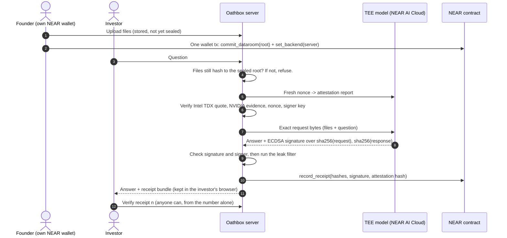

<p align="center"></p>

# Oathbox

**Private due diligence. Investors get answers, not the founder's files.**

A founder seals a data room (metrics, cap table, contracts, code) by writing its fingerprint to NEAR from their own wallet. An investor asks questions. A model running inside a trusted execution environment (Intel TDX + NVIDIA confidential computing on NEAR AI Cloud) reads the files and answers. Every answer leaves a receipt on NEAR that anyone can check: which model answered, that it ran in genuine TEE hardware, and that the files were exactly the ones sealed. The investor never sees the files.

Built for the NEAR hackathon, Privacy track.

- **Live demo:** [oathbox.tech](https://oathbox.tech) (public demo on NEAR testnet — don't upload confidential files)
- **Contract:** [`oathbox.builtbysammy.testnet`](https://testnet.nearblocks.io/address/oathbox.builtbysammy.testnet) on NEAR testnet
- **First real receipt:** receipt #0, [transaction `4RXpq783…GKVqKZg`](https://testnet.nearblocks.io/txns/4RXpq783rnK5hgvcFxg3X5YAeiVSWLHWXouTMGKVqKZg)
- **Demo video:** _link added on submission_ · **X post:** _link added on submission_

---

## How it works



1. **Seal.** The founder connects a NEAR wallet (MyNearWallet or Meteor) and proves the account is theirs by signing a one-time message (NEP-413, no transaction). They upload files, then approve **one** transaction that seals the room's root hash under their own account and allow-lists this server to record receipts. The room is owned on chain by the founder, not by Oathbox.
2. **Ask.** Before anything reaches the model, the server re-hashes the files. If even one byte changed since the seal, it refuses and records nothing.
3. **Attest.** Each question gets a fresh 32-byte nonce. The server fetches the TEE's attestation report for that nonce and checks it (table below). If any check fails (Intel TDX quote, debug mode, signer binding, nonce binding, workload config, RTMR3 replay, GPU evidence, or NVIDIA NRAS), Oathbox returns HTTP 403 and no file content is sent to the model.
4. **Answer.** Only after those checks pass does the server send the exact request bytes to the attested model. The model's TEE signs `model:sha256(request):sha256(response)`. The server checks that signature and that the signer is the key it just attested.
5. **Filter.** A leak filter rejects answers that copy code, data rows, long passages or any part of a secret from the files. A rejected answer is "withheld" and leaves no receipt.
6. **Receipt.** The receipt on NEAR holds only hashes, the signature, the model id, the nonce and the attestation report's hash. The question and answer text stay with the investor.

## What a receipt proves

Open **Verify** and enter a receipt number. These checks re-run every time from public data: the receipt on NEAR plus the public attestation report it points to.

| Group | Check |
|---|---|
| On NEAR | The receipt is for the data-room root sealed on chain |
| | The stored attestation report matches the hash in the receipt |
| TEE attestation | The report was generated for this question's nonce |
| | Intel TDX quote is genuine (DCAP verification with `dcap-qvl` against Intel's TCB collateral) |
| | The TEE is not in debug mode |
| | The signing key is bound into the quote's report data |
| | The nonce is bound into the quote |
| | The workload config (app compose) matches the quote |
| | The event log replays to the measured RTMR3 |
| | The GPU evidence is for this nonce |
| | NVIDIA's attestation service accepts the GPU |
| Signature | The completion signature is valid over the on-chain hashes |
| | The signer is the attested TEE key in the stored report |

With the investor's saved receipt (downloaded or kept in their browser), four more checks run: the saved response matches the on-chain response hash, the answer is exactly what the TEE returned, and the answer and question match their hashes. The founder, who has the files, can also rebuild the exact request and match its hash.

### What it does not prove

- **That the answer is correct.** Models make mistakes. The receipt proves where an answer came from, not that it is true.
- **That the founder sealed every relevant file.** A founder can leave a document out.
- **Which exact machine answered.** All instances of a model share one signing key, so a match proves "a genuine TEE running this model", not one specific instance.
- **The NVIDIA token's own signature.** We use the NVIDIA attestation service's verdict but do not yet verify its JWT signature (shown as such in the check list).

## Privacy

| Data | Where it lives |
|---|---|
| Founder's files | Persist on the Oathbox server in `rooms/`. They are not deleted after an answer. They are sent to the model only after attestation passes. Only the owner sees file names in the app. Real deployments should self-host. |
| Question and answer text | Only in the investor's browser and their downloaded receipt file. The server does not store them ([`pipeline.py`](backend/oathbox/pipeline.py) writes nothing to disk). |
| On NEAR | Room root hash, file count, owner; per receipt: hashes, signature, model id, nonce, attestation hash. |
| Server state (`.oathbox/`) | Public attestation reports, per-room file paths and hashes (to name a changed file), room owner and status, uploaded rooms. See [`store.py`](backend/oathbox/store.py). |

**Trust note.** The TEE keeps the files from the AI provider, and receipts keep investors from having to trust anyone. The founder does have to trust whoever runs the Oathbox server, because it holds the files. For real use, a founder should run Oathbox themselves; the next step is running the server itself inside a TEE.

### Leak filter limits

Answers are compared with the sealed files after collapsing whitespace. An answer is withheld if it repeats:

| From | Limit |
|---|---|
| Data files (`.csv`, `.json`, `.yaml`, `.env`, …) | any 40 characters in a row |
| Code files (`.py`, `.js`, …) | 40 characters of code-like text |
| Documents (`.md`, `.txt`, …) | 40 characters inside fenced code blocks |
| Any file | 120 characters of any text (about one long sentence) |
| Secrets (API keys, tokens, private keys) | any 12 characters of one |

So an answer may restate one sentence of a pitch deck, but not code, data rows, whole paragraphs or secrets. The model is also told never to quote files and never to name people ([`prompt.py`](backend/oathbox/prompt.py)).

## Quickstart

**You need:** Python 3.11+, Node 18+, a [NEAR AI Cloud](https://nearbuilders.org/join) API key, and a NEAR **testnet** account with about 1 testnet NEAR for the server. To try the founder flow you also need a testnet wallet (MyNearWallet or Meteor). Rust is **not** required: the contract is prebuilt and deployed.

```bash
git clone https://github.com/Depthhub/oathbox.git
cd oathbox
make install            # Windows PowerShell: .\scripts\install.ps1
```

Fill in `.env` (created from `.env.example`): `NEARAI_API_KEY`, `NEAR_ACCOUNT_ID`, `NEAR_PRIVATE_KEY`, and a unique `SAMPLE_ROOM_ID`. Then:

```bash
make test               # 53 backend tests, no network, no credits
make e2e                # the whole flow against testnet + the real TEE
make demo               # http://127.0.0.1:8000   (Windows: .\scripts\demo.ps1)
```

`make e2e` uses one TEE answer and two small testnet transactions. You will see:

1. The sample room (fictional Ledgerlight) sealed by your server account, with its transaction link.
2. "Is MRR growing month over month?" answered with `badge: verified` and a receipt transaction.
3. Verification as an outsider (receipt number only): every TEE and signature check `PASS`.
4. Verification as the investor (with the saved receipt): question, answer and response hashes `PASS`.
5. A forged answer: `failed`.
6. The tamper demo: one number in `metrics.csv` changed after sealing, the question refused with `409 room_changed` naming `metrics.csv`, nothing recorded, then restored.

**Founder flow in the app:** open `http://127.0.0.1:8000/#new`, connect your wallet, confirm it's you, upload a folder, click **Seal in wallet**, then copy the investor link from the Founder page and ask away. Every answer links to its receipt on the **Verify** page.

## Deploy

The live demo at **[oathbox.tech](https://oathbox.tech)** runs on **Azure Container Apps** (Azure for Students credit). GitHub Actions builds the [`Dockerfile`](Dockerfile) into `ghcr.io/depthhub/oathbox` on every push ([`.github/workflows/image.yml`](.github/workflows/image.yml)); the app is defined in [`azure/containerapp.yaml`](azure/containerapp.yaml) with an Azure Files share mounted at `/data`; [`scripts/azure-set-secrets.ps1`](scripts/azure-set-secrets.ps1) copies the three keys from `.env` into encrypted Container App secrets without printing them. Python dependencies are pinned by [`backend/requirements.lock`](backend/requirements.lock). A Render Blueprint, [`render.yaml`](render.yaml), is included as an alternative.

- **Persistent disk at `/data`** (`OATHBOX_STATE_DIR`): uploaded rooms, attestation reports and room owners must survive restarts.
- **`PUBLIC_DEMO=1`** shows a "don't upload confidential files" notice and turns off the tamper switch.
- **Limits** keep strangers from spending your credits: `ASK_LIMIT_PER_HOUR` per visitor, `ASK_LIMIT_PER_DAY` in total, plus `UPLOAD_LIMIT_PER_HOUR` and `VERIFY_LIMIT_PER_HOUR`. All are off when unset (local use).
- **[`attestations/`](attestations)** ships the public attestation reports for receipts made before a deployment, so they still verify on a fresh server.

## The contract

[`contract/src/lib.rs`](contract/src/lib.rs), Rust with `near-sdk` 5.30. Prebuilt wasm: [`contract/res/oathbox_contract.wasm`](contract/res/oathbox_contract.wasm) (sha256 `043bd113cdbe9e17cdfecea2047605c5878f6d903453a931008f0421335af2c3`, matching the deployed code). Deploy transaction: [`3HEXFFVP…`](https://testnet.nearblocks.io/txns/3HEXFFVP1pBHdRt3hpJzow4qy8TGXL33hjHvwokNkk2j).

| Method | Who | What |
|---|---|---|
| `commit_dataroom(id, root_hash, file_count)` | anyone | Seals a room; the caller becomes its owner. Immutable. |
| `set_backend(dataroom_id, account)` | room owner | Allow-lists a server to record receipts. |
| `record_receipt(...)` | owner or allow-listed server | Stores a receipt; panics unless the root matches the sealed one. |
| `get_dataroom`, `get_receipt`, `get_receipts`, `get_backends`, `receipt_count` | anyone | Views. |

Writes are paid by the caller: attach a deposit, the contract keeps the exact storage cost and refunds the rest. To deploy your own: `python scripts/deploy_contract.py` (dry run), then add `--yes`. To rebuild the wasm: `make contract` (needs Rust and `cargo-near`).

## Repository

```
backend/    FastAPI app, TEE client, verification, leak filter, NEAR client, tests
  oathbox/  app.py  auth.py  chain.py  disclosure.py  hashing.py  pipeline.py
            prompt.py  store.py  tamper.py  tee.py  verify.py
  scripts/  e2e.py (full real run)  smoke.py (TEE path only)
contract/   NEAR smart contract (Rust) + prebuilt wasm in res/
web/        React + Vite app (Founder, Investor, Verify, New room)
scripts/    deploy_contract.py, install.ps1, demo.ps1
sample-dataroom/  Fictional "Ledgerlight" data room used by e2e.py
```

## Limitations and next steps

- **Testnet only.** Not audited.
- **Founder files persist on the server** in `rooms/`. The operator can read them, including after each answer. Real deployments should self-host. Running the server itself inside a TEE, so the operator can't read the files either, is a later step.
- **Verification runs on the Oathbox server.** The checks are open source and use only public data, so anyone can re-run them from this repo; an in-browser verifier is a natural next step.
- **Small rooms.** The whole room goes into the model's context on every question, so rooms are limited to 300 KB and 100 files of plain text. PDFs and spreadsheets should be exported as text or CSV.
- **Anyone with the room link can ask.** Founder actions need a wallet sign-in; investor invite codes are not built yet.
- **The leak filter is a heuristic.** It stops copying, not clever paraphrase. The prompt rules and the TEE's isolation are the other layers.
- **Next:** import a private GitHub repo as a room, investor invites, in-browser verification, mainnet.

## Built with

| Part | Libraries (license) |
|---|---|
| Backend | FastAPI (MIT), Uvicorn (BSD-3), httpx (BSD-3), python-dotenv (BSD-3), python-multipart (Apache-2.0), eth-account (MIT), dcap-qvl (MIT), near-kit (MIT), pydantic (MIT), pytest (MIT) |
| Web | React 18 (MIT), Vite 5 (MIT), NEAR Wallet Selector 10.1.4: core, modal-ui, my-near-wallet, meteor-wallet (MIT or Apache-2.0), buffer (MIT) |
| Contract | near-sdk 5.30 (MIT or Apache-2.0), built with cargo-near |
| Services | NEAR AI Cloud (TEE inference + attestation), NEAR testnet RPC, Intel TDX collateral (fetched by dcap-qvl), NVIDIA attestation service (NRAS) |
| Design | Kujua design system (the author's own), Inter (SIL OFL). NEAR logo copied unaltered from near.org. |

**Ported code.** The attestation and signature checks in [`verify.py`](backend/oathbox/verify.py) are ported from NEAR AI Cloud's published reference helpers ([docs.near.ai](https://docs.near.ai/cloud/verification/) — quote/nonce/signer and response-signature verification) and [`nearai/nearai-cloud-verifier`](https://github.com/nearai/nearai-cloud-verifier) (MIT).

**AI assistance.** Most of the code in this repository (backend, contract, web app, tests and scripts) was written with Claude (Anthropic) through Claude Code, directed, reviewed and tested by the author on NEAR testnet and NEAR AI Cloud. The sample data rooms are fictional and were also AI-generated. All code was written after 19 October 2026.

## License

[MIT](LICENSE)
